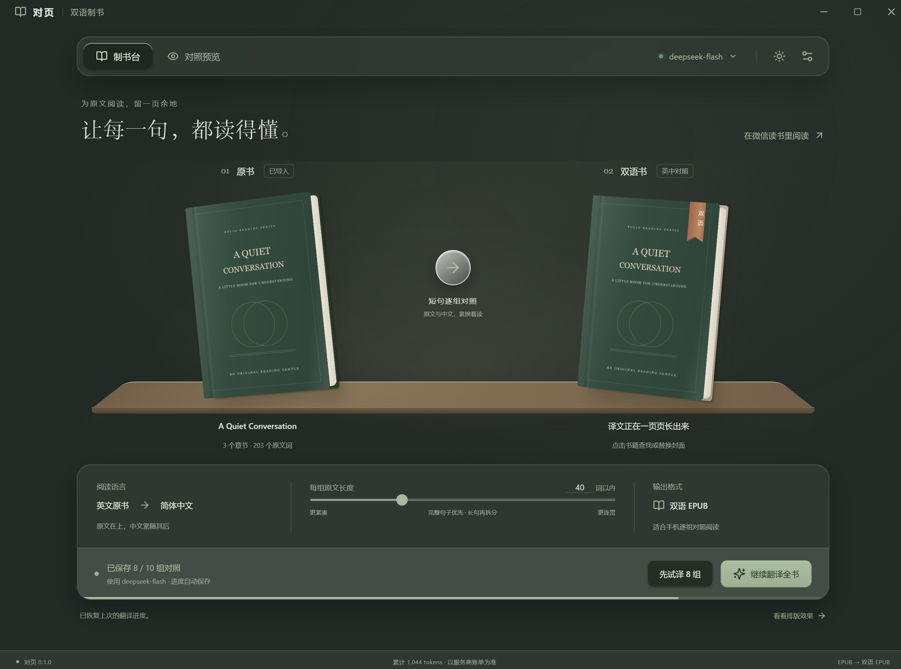

# Folio · 对页

把英文 EPUB 做成**双语对照书**的 Windows 桌面工具：每组短原文在上，对应中文紧贴在下，译完拖进微信读书或任何 EPUB 阅读器就能读。

免安装，离线解析原书；只在翻译时把你选中的原文发给自己的模型服务。


## 下载

Windows 10/11 x64 免安装版：[Folio 0.1.0](https://github.com/Neocvsu-commits/Folio/releases/tag/v0.1.0)（约 98 MB，未签名，首次运行 SmartScreen 可能提示）。

## 为什么不用现成工具

能翻整本书的工具不少，但大多把正文整段替换成中文，或者把译文堆成另起一段的大块。读完一段英文要往下找半天对应中文，阅读体验就散了。

Folio 只做一件事：把书切成 15–100 词的短句组（默认 40 词，优先取完整句子），原文与译文上下相邻，原书的样式、目录层级、图片和包结构全部保留。翻完还是一本书，不是一叠对照表。

## 功能

- **短句组对照**：优先保留完整句子；特别长的句子先按分句、再按词边界拆分，长度可在 8–100 词之间调
- **不动原书**：不覆盖原文件，保留 OPF 清单、目录层级、资源路径、图片、样式和英文行内标记（斜体、链接尽量留在切分后的原文里）
- **先试译 8 组**：在"对照预览"里挑有正文的章节看效果，满意再翻全书
- **断点续译**：暂停、关窗、请求失败都会保存已完成的结果，重启会尝试打开上次的原书
- **配置隔离缓存**：模型、服务地址、翻译偏好或对照长度一变就用独立缓存，切回旧配置能恢复旧进度
- **模型自由**：兼容 OpenAI Chat Completions 协议，DeepSeek 预填；自定义网关、Ollama、LM Studio 同样可用
- **拖出即成书**：把右侧书籍拖到资源管理器或"另存为 EPUB"；支持换封面、按书名搜索封面

## 界面

制书台提供浅色与深色两套主题，导入原书后右侧书籍随翻译进度生长：

| 正常模式 | 暗夜模式 |
| :--- | :--- |
|  |  |

短句组对照效果（应用内预览，模拟手机排版；实际字体与分页由阅读器决定）：


## 使用

1. 打开 `Folio-0.1.0-Windows.exe`。免安装版，首次解包需要几秒。
2. 点右上角"连接翻译模型"。DeepSeek 已预填服务地址 `https://api.deepseek.com`、模型 `deepseek-flash`；填入自己的密钥，测试连接并保存。模型名可直接编辑。
3. 拖入 EPUB，或点击左侧书籍。
4. 设置每组的词数上限（默认 40，可调 15–100）。
5. 点"先试译 8 组"，在"对照预览"选择有正文的章节查看效果；满意后翻译全书。
6. 完成后把右侧书籍拖到资源管理器/桌面，或"另存为 EPUB"。点击右侧书籍可换封面，也可按书名打开浏览器图片搜索，下载图片后再选择。
7. 用微信读书官方网页的传书入口上传，或在手机上用微信读书打开该 EPUB。

试译只保留前 8 个对照单元的结果，未完成全书时不导出。客户端入口及最终字体、分页以微信读书当前版本为准。

## 模型接口

支持兼容 OpenAI Chat Completions 的服务，包括 DeepSeek、自定义网关，以及提供该协议的 Ollama / LM Studio。

| 配置 | 说明 |
| --- | --- |
| 服务地址 | 例如 `https://api.deepseek.com` 或 `https://provider.example/v1`。自动补 `/chat/completions`，已填完整地址时不会重复补。 |
| 模型 | 服务商提供的模型 ID，不在代码中绑定。 |
| 密钥 | 在应用内填写，用 Windows DPAPI 加密后存进 `%APPDATA%\Folio\settings.json`。远程接口要求 HTTPS，本机回环地址可用 HTTP。 |
| 翻译偏好 | 可填写风格要求、术语映射等。 |
| 并发 | 1–4，默认 2。额度不足或限流时调低。 |

每批最多 8 组原文，带相邻原文上下文。请求要求返回带原始编号的 JSON，程序校验编号、完整性、重复、空白和截断；格式不对或临时失败最多重试 3 次，错误结果不会写进书里。

测试连接、重试和正式翻译都会产生 API 费用，实际计费以服务商为准。接入其他协议时，在 `src/core/provider.ts` 扩展请求层：`translateBatch` 返回 `{ translations, input, output }`，其中 `translations` 是单元 ID 到中文的映射，EPUB 处理、缓存、桌面 UI 不需要知道具体模型协议。应用不开放 HTTP 服务端口。

DeepSeek 预填值核对日期：2026-10-08，[官方接口文档](https://api-docs.deepseek.com/zh-cn/)。

## 边界与限制

- 保留原 EPUB 的清单、目录层级、资源路径、图片、样式和原文行内标记，只在正文中加入译文，并调整双语书标题与必要元数据；原文件不被覆盖。
- 新增中文是纯文本，不会自动复制英文内部的粗体/斜体位置。
- 按阅读顺序处理正文和标题，保留原始导航目录文字；跳过导航页、代码块、公式、图片里的字和标记为不翻译的内容。
- 当前面向英文到简体中文。
- 不支持内容加密、扫描图版或固定版式 EPUB；单文件上限 200 MB，解压后上限 450 MB。
- 并排校对只用于应用内预览，正式书稿采用上下对照。微信读书实机导入需用自己的书验证，不能承诺与预览的字体、行距、分页完全一致。
- 书籍在本地解析；试译/翻译时原文与上下文会发送到所选的模型服务，查找封面会用书名和作者打开 Bing 图片搜索。

## 数据目录

`%APPDATA%\Folio`

| 路径 | 内容 |
| --- | --- |
| `settings.json` | 设置与 Windows 加密的密钥 |
| `progress` | 译文缓存 |
| `covers` | 替换封面 |
| `exports` | 已完成的双语书 |

密钥不进入 EPUB，也不进源码。

## 工程结构

- `src/core/segment.ts`：句子/分句切分、原文标记切片
- `src/core/epub.ts`：EPUB 读取、结构保留、封面、双语导出
- `src/core/provider.ts`：模型调用、响应校验与重试
- `src/core/engine.ts`：任务状态、进度、缓存、暂停续译
- `src/desktop`：后台 Worker、Windows 密钥保护、文件对话框与原生拖出
- `src/ui`：React 视图、样式、模型设置、阅读预览

测试使用临时数据目录与本机模拟接口，不读取用户保存的模型密钥。`FOLIO_TEST_DATA`、`FOLIO_HEADLESS` 仅用于隔离测试，普通使用无需设置。

## 开发与构建

Node.js 22.12+、npm、Windows x64。

```powershell
npm install
# npm 若未运行 Electron 安装脚本，再执行下一行
node node_modules/electron/install.js
npm run typecheck
npm test
npm run build
npm start
npm run package
```

`npm run package` 生成 `release/Folio-0.1.0-Windows.exe`。`npm run dev` 仅用于前端开发，完整导入与导出需在 Electron 中运行。

```powershell
npx tsx scripts/sample.ts
npm run smoke
node scripts/verify-portable.mjs release/Folio-0.1.0-Windows.exe
```

## 相关工程

| 项目 | 可直接使用的部分 | 与本工具需求的关系 |
| --- | --- | --- |
| [BabelEbook](https://github.com/nevertiree/babel-ebook) | Windows 桌面版、DeepSeek、多模型、双语输出；MIT | 最接近的现成应用，交互更偏通用翻译工作台。 |
| [Ebook Translator for Calibre](https://github.com/bookfere/Ebook-Translator-Calibre-Plugin) | Calibre 内翻译、缓存、多种引擎；GPL-3.0 | 适合已用 Calibre 的用户，依赖 Calibre 的界面与工作流。 |
| [bilingual_book_maker](https://github.com/yihong0618/bilingual_book_maker) | 命令行制作双语 EPUB、多模型接口 | 适合脚本流程，实体书桌面交互需另做。 |
| [BookTranslator](https://www.booktranslator.app/zh-CN/epub-translator) | 在线翻译、双语输出 | 在线服务，无法作为本地桌面工程接入。 |

本项目是独立实现，用 JSZip / JSDOM 处理 EPUB，没有把上面任何项目整体嵌入应用。调研仅作方案比较，未向上游提交或发布代码。

## 第三方组件

Electron、React、JSDOM、JSZip、entities、lucide-react 等按各自许可证分发，完整依赖版本见 `package-lock.json`。示例 EPUB 中的英文、中文和封面为本项目原创测试素材。
